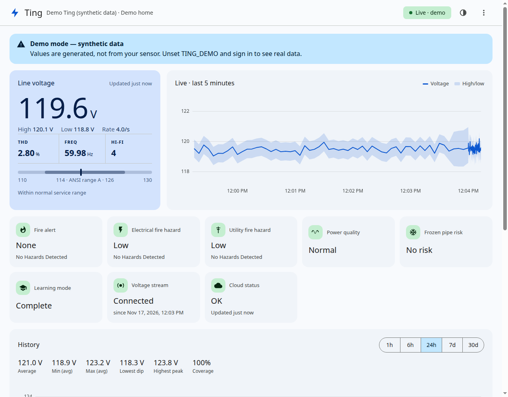
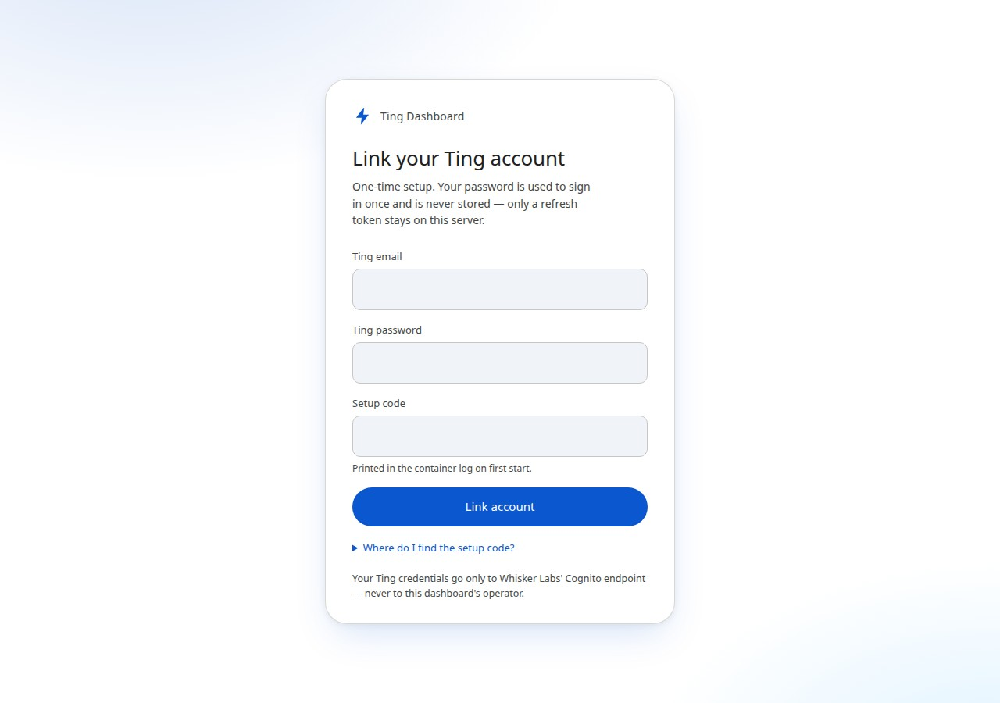

# Ting Dashboard

A self-hosted web dashboard for a **Whisker Labs Ting** electrical fire sensor —
the thing you plug in to catch bad wiring — replacing the iOS/Android app with
something you can open on a wall tablet, a TV, or any browser in the house.



Ting itself is cloud-only: the plug exposes no local ports (a full TCP scan and
UDP probes come back empty), so this project talks to the same unofficial API the
mobile apps use, keeps the history locally in SQLite, and serves a Material 3 UI
that needs no internet access to render.

## What you get

- **Live voltage**, ~4 samples/second streamed over SSE, with a high/low
  envelope, sample rate, and ANSI C84.1 range-A markers
- **Signal strip** — every other measurement the voltage frame carries, shown
  beside the reading: THD, line frequency, and the peak ("hi-fi") count. Fields
  are passed through from the payload, so a new one appears without a code
  change.
- **Hazard tiles** — fire alert, electrical fire hazard, utility fire hazard,
  power quality, frozen-pipe risk, learning mode, cloud poll age
- **History** — 5-second buckets in SQLite, downsampled on the fly for
  1h / 6h / 24h / 7d / 30d views, with avg, min, max, peak, dip, and coverage
- **Alerts** — Ting's notification history plus a de-duplicated log of status
  changes, so you can see when the hazard state flipped and back
- **Material 3** light and dark themes, installable as a PWA, no CDN, no
  JavaScript framework, strict CSP
- **Docker-first** — one container, one volume, runs as your own uid/gid so the
  data directory stays yours

## Quick start

```bash
git clone https://github.com/joescars/ting-dashboard.git
cd ting-dashboard
./scripts/setup.sh          # creates .env with a generated password, builds
docker compose up -d
```

Prefer the prebuilt image over a local build? Copy
[`examples/docker-compose.yml`](examples/docker-compose.yml) instead — same stack,
pinned to the released tag, no clone-and-build:

```bash
mkdir -p ~/ting && cd ~/ting
curl -O https://raw.githubusercontent.com/joescars/ting-dashboard/main/examples/docker-compose.yml
curl -o .env https://raw.githubusercontent.com/joescars/ting-dashboard/main/.env.example
$EDITOR .env                      # set DASHBOARD_PASSWORD
docker compose up -d
```

Then open `http://<host>:8097`, sign in with the password `setup.sh` printed
(also in `.env`), and link your Ting account when the setup page appears:



The setup page wants a **one-time code** from the container log:

```bash
docker compose logs ting | grep -A2 "setup code"
```

(or `sudo cat data/setup_token`). Your Ting password is used once to sign in to
Whisker Labs' Cognito endpoint and is never stored — only a refresh token is,
in `data/auth.json` with mode `0600`. After that the code is deleted and the
setup page stops accepting requests.

Prefer credentials in a file? Put `TING_EMAIL` and `TING_PASSWORD` in `.env`
instead and skip the browser step; the password is still only used once, and you
can remove it afterwards.

Just want to look at it first?

```bash
docker compose run --rm -e TING_DEMO=1 -p 8097:8097 ting
```

serves synthetic data with no account at all.

## Configuration

Everything is environment variables in `.env` (see `.env.example`).

| Variable | Default | Purpose |
| --- | --- | --- |
| `DASHBOARD_PASSWORD` | *empty* | Password for the UI. Empty = open to anyone who can reach the port. |
| `TING_EMAIL` / `TING_PASSWORD` | *empty* | Optional one-time sign-in instead of the browser setup page. |
| `SETUP_TOKEN` | *generated* | Pin the `/setup` code instead of using the generated one. |
| `TING_PORT` | `8097` | Host port. |
| `TING_POLL_INTERVAL` | `60` | Seconds between status polls (min 30). |
| `TING_NOTIFICATION_INTERVAL` | `300` | Seconds between alert-history fetches (min 60). |
| `TING_BUCKET_SECONDS` | `5` | Voltage history resolution. |
| `TING_RETENTION_DAYS` | `90` | Days of voltage history kept. |
| `TING_DEMO` | `0` | `1` = synthetic data, no account. |
| `TING_UID` / `TING_GID` | `1000` | uid/gid the container runs as; must own `./data`. |
| `LOG_LEVEL` | `INFO` | Python log level (`DEBUG` logs decoded payload fields). |

Configuration changes need `docker compose up -d` (recreate) to apply.

## HTTP API

The UI is a thin client over these; they are read-only apart from the auth
endpoints, and no endpoint mutates Ting state.

| Endpoint | Purpose |
| --- | --- |
| `GET /api/state` | auth state, devices, hazard status, stream state, `signal` (THD/frequency/peaks) |
| `GET /api/recent?station=SERIAL` | last 5 minutes of samples (seeded from history) |
| `GET /api/history?station=SERIAL&range=1h\|6h\|24h\|7d\|30d` | downsampled buckets |
| `GET /api/events?station=SERIAL` | notifications + status-change log |
| `GET /api/live` | SSE stream: `state`, `sample` events |
| `GET /api/session` | whether a password is required, whether you are signed in |
| `GET /api/version` | version and upstream protocol source |
| `POST /api/login`, `POST /api/logout` | dashboard session |
| `POST /api/setup` | one-time account linking (needs the setup code) |
| `POST /api/unlink` | forget the stored refresh token |
| `GET /healthz` | liveness probe |

## Exposing it beyond your LAN

Set `DASHBOARD_PASSWORD` (or front it with oauth2-proxy / Authelia / Cloudflare
Access) **and** terminate TLS at a reverse proxy. The app sets `Secure` on
cookies when it sees `X-Forwarded-Proto: https`, and reads
`X-Forwarded-For`/`X-Real-IP` for the setup-code network check. See
[SECURITY.md](SECURITY.md) for the full picture.

## How it works

```
Ting plug ──cloud──► Whisker Labs API ──► this container ──► browser
                        (Cognito auth)      SQLite + SSE
```

1. AWS Cognito SRP sign-in (`us-east-1` pool) → access + refresh token
2. REST `GET api.wskr.io/api/v1/Users/{id}` → devices, hazard status, learning mode
3. SignalR MessagePack hub `wss://signalr.api.wskr.io/dataHub` → live voltage frames

- `app/authz.py` — dashboard sessions, setup codes, private-network check
- `app/auth.py` — Cognito SRP sign-in and token refresh
- `app/client.py` — REST polling, token lifecycle, refresh-token store
- `app/stream.py` — SignalR MessagePack client for the ~4 Hz voltage stream
- `app/store.py` — SQLite buckets, retention pruning, query-time downsampling
- `app/main.py` — aiohttp routes, SSE fan-out, demo generator
- `static/` — hand-written Material 3 frontend (canvas charts, no dependencies)

## Troubleshooting

| Symptom | Fix |
| --- | --- |
| `The data directory /data is not writable` | `sudo chown -R $(id -u):$(id -g) ./data`, or set `TING_UID`/`TING_GID` in `.env`. |
| Setup page says the code is invalid | Codes rotate when an account is unlinked. Re-read it: `docker compose logs ting \| grep -A2 "setup code"`. |
| "Sign-in failed" with a Ting error | Check the email/password by logging into the Ting app; the API only accepts accounts the app can use. |
| Dashboard shows *signed out* after working for weeks | The refresh token was revoked (password change, app re-login). ⋮ menu → *Unlink Ting account*, then link again. |
| No live voltage but status works | The SignalR hub rejected the stream; check `docker compose logs ting` for `StreamRejected`. It retries with backoff. |
| History empty after an update | The bucket schema is stable, but a downgrade can drop columns. Restore `./data` from a backup. |

## Development

```bash
python3 -m venv .venv && .venv/bin/pip install -r requirements-dev.txt
.venv/bin/python -m pytest -q          # 18 tests, no network
TING_DEMO=1 .venv/bin/python -m app.main
```

The tests cover storage bucketing, API parsing, auth persistence, the dashboard
password/session flow, the setup flow, and the SignalR client against a local
fake hub. See [CONTRIBUTING.md](CONTRIBUTING.md).

## Disclaimer

The Whisker Labs API used here is **unofficial and undocumented**; it can change
without notice. This project is not affiliated with, endorsed by, or supported
by Whisker Labs. Keep the official Ting app installed — this dashboard is a
second screen for the data, not a replacement for Ting's alerting.

Protocol and authorization flow adapted from
[simplytoast1/ha-whisker-ting](https://github.com/simplytoast1/ha-whisker-ting)
(MIT) — see `THIRD_PARTY_LICENSE_ha-whisker-ting`.

## License

MIT — see [LICENSE](LICENSE).
